# Casos de Uso — TranSystem Twins

**Plataforma Modular para la Construcción y Evaluación de Gemelos Digitales de Sistemas de Transporte Inteligente** — Instituto Mexicano del Transporte (IMT)

Este documento fusiona dos fuentes:


Convención de estado:

| Estado | Significado |
|---|---|
| **Implementado** | Existe y opera en el código actual (backend y/o frontend). |
| **WIP (Work in Progress)** | En desarrollo activo en backend, motor SUMO o frontend. |
| **Pendiente (simulado)** | Servicio simulado o prototipo en memoria que requiere integración final. |
| **Planificado** | Diseñado y especificado funcionalmente, pendiente de implementación. |
| **Por probar** | Implementado a nivel de generación/descarga, en fase de validación de pruebas. |

## Índice
1. [Arquitectura y canales de comunicación](#1-arquitectura-y-canales-de-comunicación)
2. [Actores](#2-actores)
3. [Modelo de datos](#3-modelo-de-datos)
4. [Resumen y diagrama general de casos de uso](#4-resumen-y-diagrama-general-de-casos-de-uso)
5. [Casos de uso implementados](#5-casos-de-uso-implementados)
6. [Casos de uso en desarrollo (WIP) y simulados](#6-casos-de-uso-en-desarrollo-wip-y-simulados)
7. [Casos de uso planificados](#7-casos-de-uso-planificados)
8. [Casos de uso por probar](#8-casos-de-uso-por-probar)
9. [Catálogo de errores](#9-catálogo-de-errores)
10. [Notas y observaciones](#10-notas-y-observaciones)

---

## 1. Arquitectura y canales de comunicación

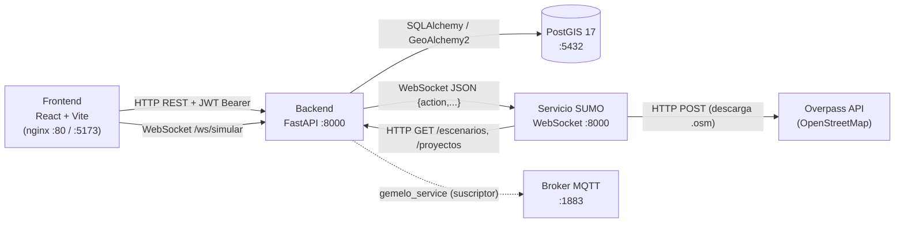

| Canal | Origen → Destino | Formato | Autenticación |
|---|---|---|---|
| REST | Frontend → Backend | JSON (`application/json`); login también acepta `x-www-form-urlencoded` | `Authorization: Bearer <JWT>` (excepto `/auth/register`, `/auth/login`, `/points`, `/red`, simulación) |
| WebSocket | Frontend → Backend (`/ws/simular`) | Texto JSON | Ninguna a nivel de socket |
| WebSocket | Backend → SUMO (`ws://sumo:8000`, fallback `ws://localhost:8000`) | Texto JSON `{"action": ..., ...}` | Ninguna |
| REST | SUMO → Backend (`BACKEND_URL`) | JSON | Ninguna (consume `GET /escenarios/{id}` y `GET /proyectos/{id}`) |
| HTTP | SUMO → Overpass | `application/x-www-form-urlencoded` con query Overpass QL | — |
| SQL | Backend → PostGIS | SQLAlchemy | `DATABASE_URL` |
| MQTT | Simulador → `gemelo_service` | JSON en tópico `transystem/vehiculos_por_minuto` | — |
      
## 2. Actores

| Actor | Descripción |
|---|---|
| **Investigador** (Especialista IMT) | Usuario humano registrado (rol por defecto `"Investigador"`). Crea proyectos y escenarios, simula, compara y consulta resultados. |
| **Backend (FastAPI)** | Autentica, aplica reglas de negocio, persiste y hace de proxy hacia SUMO. |
| **Servicio SUMO** | Microservicio que importa zonas, aplica modificaciones y ejecuta simulaciones. |
| **Overpass API / OpenStreetMap** | Servicio externo que provee la red vial importable. |
| **Simulador MQTT** | Publica vehículos por minuto hacia el gemelo digital. |
| **Gemelo digital** (planificado) (sensores, cámaras, GPS) | Sistema externo que publica conteos vehiculares reales en el broker MQTT. |

## 3. Modelo de datos

### 3.1 Diagrama entidad-relación (PostgreSQL)

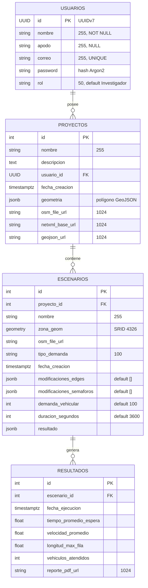

Las FK tienen `ON DELETE CASCADE`: borrar un usuario elimina sus proyectos, escenarios y resultados.

### 3.2 Esquemas de datos intercambiados (Pydantic)

```mermaid
classDiagram
    class CreateUser {
        +str nombre
        +str apodo?
        +EmailStr correo
        +str password
        +str rol = "Investigador"
    }
    class UpdateUser {
        +str nombre?
        +str apodo?
        +EmailStr correo?
        +str password?
        +str rol?
    }
    class UserResponse {
        +UUID id
        +str nombre
        +str apodo?
        +EmailStr correo
        +str rol
    }
    class LoginUser {
        +EmailStr correo
        +str password
    }
    class Token {
        +str access_token
        +str token_type
    }
    class CreateProyecto {
        +str nombre
        +str descripcion?
        +dict geometria?
    }
    class UpdateProyecto {
        +str nombre?
        +str descripcion?
        +dict geometria?
    }
    class ProyectoResponse {
        +int id
        +str nombre
        +str descripcion?
        +UUID usuario_id
        +datetime fecha_creacion
        +dict geometria?
        +str osm_file_url?
        +str netxml_base_url?
        +str geojson_url?
    }
    class CreateEscenario {
        +int proyecto_id
        +str nombre
        +Any zona_geom?
        +str osm_file_url?
        +str tipo_demanda?
        +str interseccion_ref?
        +int demanda_vehicular = 100
        +int duracion_segundos = 3600
    }
    class UpdateEscenario {
        +str nombre?
        +int proyecto_id?
        +int demanda_vehicular?
        +int duracion_segundos?
        +list~dict~ modificaciones_edges?
        +list~dict~ modificaciones_semaforos?
        +otros campos de CreateEscenario?
    }
    class ModificarEdge {
        +int carriles [1..10]
        +float velocidad_max [5..120]
    }
    class FaseSemaforo {
        +int indice
        +int duracion? [1..300]
        +str estado?
    }
    class ModificarSemaforo {
        +list~FaseSemaforo~ fases
    }
    class EscenarioResponse {
        +int id
        +int proyecto_id
        +str nombre
        +Any zona_geom? (GeoJSON)
        +int demanda_vehicular
        +int duracion_segundos
        +list~dict~ modificaciones_edges
        +list~dict~ modificaciones_semaforos
        +dict resultado?
        +datetime fecha_creacion
    }
    class CreateResultado {
        +int escenario_id
        +float tiempo_promedio_espera?
        +float velocidad_promedio?
        +float longitud_max_fila?
        +int vehiculos_atendidos?
        +str reporte_pdf_url?
    }
    class ResultadoResponse {
        +int id
        +int escenario_id
        +datetime fecha_ejecucion
        +float tiempo_promedio_espera?
        +float velocidad_promedio?
        +float longitud_max_fila?
        +int vehiculos_atendidos?
        +str reporte_pdf_url?
    }
    class PointsPayload {
        +list~PointItem~ points
    }
    class PointItem {
        +str id
        +float lat
        +float lng
        +GeoJson geoJson
        +str street?
        +str displayName?
    }
    class GeoJson {
        +str type = "Feature"
        +dict properties
        +Geometry geometry
    }
    class Geometry {
        +str type = "Point"
        +list~float~ coordinates
    }
    ModificarSemaforo --> FaseSemaforo
    PointsPayload --> PointItem
    PointItem --> GeoJson
    GeoJson --> Geometry
```

> `CreateResultado` acepta campos extra y mapea alias enviados por SUMO: `espera_promedio` → `tiempo_promedio_espera`, `vehiculos_simulados` → `vehiculos_atendidos`.

### 3.3 Estructuras JSON libres (JSONB / mensajes)

**`modificaciones_edges[]`** (un elemento por calle modificada):
```json
{ "edge_id": "123456#0", "carriles": 3, "velocidad_max": 60.0 }
```

**`modificaciones_semaforos[]`**:
```json
{ "tls_id": "cluster_1234", "fases": [ { "indice": 0, "duracion": 30, "estado": "GGrr" } ] }
```

**`proyectos.geometria`** (polígono GeoJSON de la zona; el exterior se usa para calcular el bbox de Overpass):
```json
{ "type": "Polygon", "coordinates": [[[-99.17, 19.43], [-99.16, 19.43], [-99.16, 19.44], [-99.17, 19.43]]] }
```

**Indicadores devueltos por SUMO** (`result_analyzer.procesar_resultados`):
```json
{
  "vehiculos_atendidos": 100,
  "tiempo_promedio_espera": 12.34,
  "velocidad_promedio": 28.5,
  "longitud_max_fila": null,
  "tiempo_promedio_recorrido": 210.7
}
```
(`velocidad_promedio` en km/h; tiempos en segundos; `longitud_max_fila` puede ser `null`.)

### 3.4 Protocolo WebSocket

**Frontend ⇄ Backend** (`ws://<host>:8000/ws/simular`)

| Dirección | Mensaje |
|---|---|
| Cliente → Servidor | Payload libre JSON, p. ej. `{"escenario_id": 7, "duracion_segundos": 1800, "demanda_vehicular": 200}` |
| Servidor → Cliente (inicio) | `{"status":"iniciando","progress":5,"message":"Conectando al microservicio SUMO..."}` |
| Servidor → Cliente (avance) | `{"status":"simulando","progress":0-99,"message":"...","detail":"..."}` |
| Servidor → Cliente (fin) | `{"status":"completado","progress":100,"message":"...","detail":"...","resultado":{indicadores}}` |
| Servidor → Cliente (error) | `{"status":"error","detail":"...","message":"..."}` |

**Backend ⇄ SUMO** (`ws://sumo:8000`)

| Acción (`action`) | Solicitud | Respuesta |
|---|---|---|
| `get_red` | `{"action":"get_red"}` | `{"action":"red_response","data":<GeoJSON FeatureCollection>}` o `{"error":"...","status":409}` |
| `patch_infraestructura` | `{"action":..,"edge_id":str,"datos":{"carriles":int,"velocidad_max":float}}` | `{"action":"infra_response","ok":true,"edge_id":str}` |
| `patch_semaforo` | `{"action":..,"tls_id":str,"datos":{"fases":[FaseSemaforo]}}` | `{"action":"semaforo_response","ok":true,"tls_id":str}` |
| `simular` | `{"action":"simular","payload":{"escenario_id"?,"duracion_segundos"?,"demanda_vehicular"?}}` | Varios `{"action":"progress","progress":int,"message":str}` y finalmente `{"action":"simular_response","status":"completado","progress":100,"message":str,"data":{indicadores}}` |
| `get_resultado` | `{"action":"get_resultado"}` | `{"action":"resultado_response","data":{indicadores}}` o `{"error":"...","status":404}` |
| desconocida | — | `{"error":"Unknown action"}` |

---

## 4. Resumen y diagrama general de casos de uso

### 4.1 Resumen

| ID | Caso de uso | Módulo | Actor principal | Estado |
|---|---|---|---|---|
| CU-01 | Registrarse | Cuenta | Investigador / Visitante | Implementado |
| CU-02 | Iniciar sesión | Cuenta | Investigador | Implementado |
| CU-03 | Consultar y modificar perfil | Cuenta | Investigador | Implementado |
| CU-04 | Eliminar cuenta | Cuenta | Investigador | Implementado |
| CU-05 | Crear proyecto (zona de estudio) | Proyectos | Investigador | Implementado (mejora planificada: importación al crear) |
| CU-06 | Listar, consultar, modificar y eliminar proyectos | Proyectos | Investigador | Implementado |
| CU-07 | Visualizar la red vial | Edición | Investigador | Implementado |
| CU-08 | Modificar infraestructura vial (calle) | Edición | Investigador | Implementado |
| CU-09 | Modificar fases de semáforos | Edición | Investigador | Implementado |
| CU-10 | Configurar demanda vehicular | Edición | Investigador | Implementado (mejora planificada: flujos origen–destino) |
| CU-11 | Guardar escenario | Escenarios | Investigador | Implementado |
| CU-12 | Gestionar escenarios | Escenarios | Investigador | Implementado |
| CU-13 | Ejecutar simulación con progreso en tiempo real | Simulación | Investigador | Implementado  |
| CU-14 | Consultar y guardar resultados | Simulación | Investigador | Implementado  |
| CU-15 | Comparar escenarios por métricas | Simulación | Investigador | WIP |
| CU-16 | Guardar y consultar puntos geoespaciales | Utilidades | Investigador | Implementado |
| CU-17 | Monitoreo de vehículos por minuto (MQTT) | Gemelo digital | Simulador MQTT | pendiente (simulado) (mejora planificada: se amplía en CU-23 a CU-26) |
| CU-18 | Cerrar sesión | Cuenta | Investigador | Implementado |
| CU-19 | Crear escenario a partir de la red base | Escenarios | Investigador | Planificado (corregir front) |
| CU-20 | Duplicar escenario como alternativa | Escenarios | Investigador | Planificado |
| CU-21 | Cargar aforos desde archivo CSV | Escenarios | Investigador | Planificado |
| CU-22 | Construir red y archivos SUMO del escenario | Simulación | Sistema | WIP |
| CU-23 | Publicar datos de demanda | Demanda MQTT | Fuente de datos | Planificado |
| CU-24 | Recibir y normalizar demanda | Demanda MQTT | Sistema | Planificado |
| CU-25 | Aplicar demanda en tiempo real a la simulación | Demanda MQTT | Sistema | Planificado |
| CU-26 | Visualizar demanda en vivo | Demanda MQTT | Investigador | Planificado |
| CU-27 | Visualizar simulación en el mapa (vehículos y filas) | Simulación | Investigador | WIP |
| CU-28 | Calcular y almacenar indicadores | Simulación | Sistema | WIP |
| CU-29 | Generar reporte técnico PDF | Reportes | Investigador | Por probar |
| CU-30 | Consultar y descargar reportes | Reportes | Investigador | Por probar |

### 4.2 Diagrama general

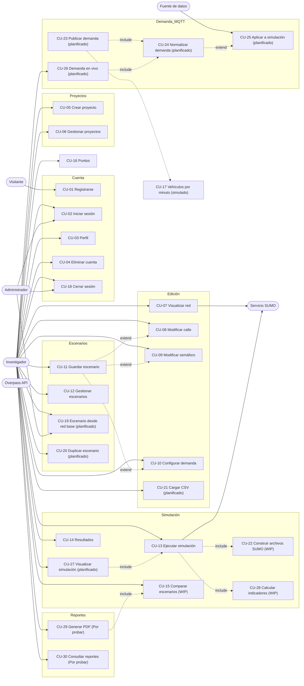

---

## 5. Casos de uso implementados

Casos de uso con implementación funcional completa en backend y frontend.

### CU-01 Registrarse
>
**Mejora planificada:** tras registrar, redirigir al login.

| Campo | Valor |
|---|---|
| Actor | Investigador |
| Precondición | El correo no está registrado |
| Endpoint | `POST /auth/register` → `201` |
| Entrada | `CreateUser`: `{"nombre":"Ana","apodo":"ana","correo":"ana@mail.com","password":"...","rol":"Investigador"}` |
| Salida | `UserResponse` (sin contraseña) |
| Postcondición | Fila en `usuarios` con `password` hasheada (Argon2) y `id` UUIDv7 |

**Flujo principal:** 1) El usuario llena el formulario. 2) El frontend (`registerApi`) envía `CreateUser`. 3) El backend valida el email (`EmailStr`) y que no exista. 4) Hashea la contraseña, inserta y responde `UserResponse`.
**Flujo alterno:** correo duplicado → `400 EmailAlreadyRegisteredException`; formato inválido → `422`.

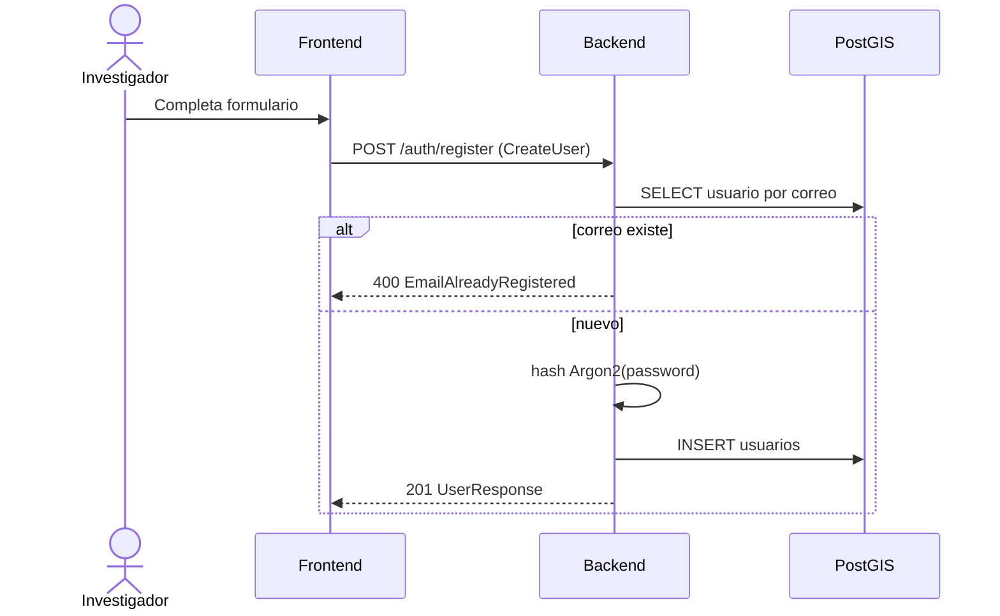


### CU-02 Iniciar sesión

| Campo | Valor |
|---|---|
| Actor | Investigador |
| Endpoint | `POST /auth/login` → `200` |
| Entrada | JSON `{"correo":"...","password":"..."}` (también `username`) **o** formulario `username`/`password` |
| Salida | `Token`: `{"access_token":"<JWT>","token_type":"bearer"}` |
| Postcondición | El frontend guarda el token y lo envía como `Authorization: Bearer` |

**Detalles:** el JWT expira a los **60 min** (claim `exp`), firmado con `SECRET_KEY` y `ALGORITHM` (HS256).
**Alterno:** faltan campos o credenciales incorrectas → `401 InvalidCredentialsException`.

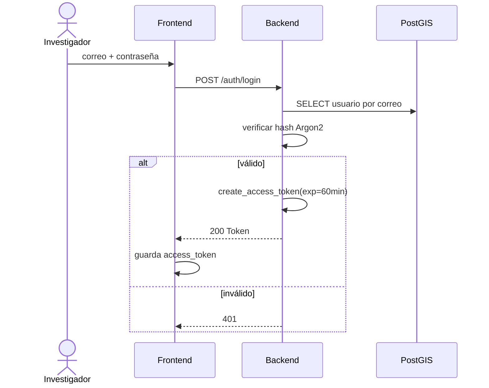


### CU-03 Consultar y modificar perfil
| Campo | Valor |
|---|---|
| Precondición | JWT válido |
| Endpoints | `GET /auth/me` → `UserResponse`; `PUT` o `PATCH /auth/me` con `UpdateUser` → `UserResponse` |
| Entrada (edición) | Cualquier subconjunto de `nombre, apodo, correo, password, rol` |
| Errores | `401 InvalidTokenException`, `404 UserNotFoundException`, `400` si el nuevo correo ya existe |

**Flujo:** el backend decodifica el JWT, carga el usuario, aplica solo los campos enviados y, si viene `password`, la vuelve a hashear.


### CU-04 Eliminar cuenta

| Campo | Valor |
|---|---|
| Endpoint | `DELETE /auth/me` → `{"mensaje":"Usuario eliminado correctamente"}` |
| Efecto | Borra el usuario y, por cascada, sus proyectos, escenarios y resultados |
| Posterior | El frontend descarta el token |


### CU-18 Cerrar sesión

| Estado | Implementado |
|---|---|
| Campo | Descripción |
|---|---|
| Actor | Investigador, Administrador |
| Precondición | Sesión activa |
| Flujo principal | 1. El usuario elige cerrar sesión. 2. El cliente elimina el JWT almacenado. 3. Se redirige al login. |
| Datos | Sin llamada al backend (el JWT es *stateless*, expira a los 60 min). Opcional: lista de revocación. |
| Postcondición | Sesión terminada |


### CU-05 Crear proyecto (zona de estudio)

| Campo | Valor |
|---|---|
| Precondición | JWT válido |
| Endpoint | `POST /proyectos/crear` → `201` |
| Entrada | `CreateProyecto`: `{"nombre":"Centro","descripcion":"...","geometria":{GeoJSON Polygon}}` |
| Salida | `ProyectoResponse` con `usuario_id` del token; `osm_file_url`, `netxml_base_url`, `geojson_url` inician en `null` |
| Postcondición | Proyecto asociado al usuario |

**Nota:** la importación de la red (descarga OSM + conversión a `.net.xml` + GeoJSON) ocurre en SUMO la primera vez que se crea el proyecto.

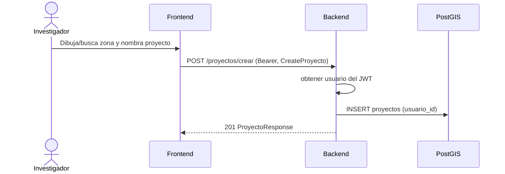


### CU-06 Listar, consultar, modificar y eliminar proyectos

| Operación | Endpoint | Entrada | Salida |
|---|---|---|---|
| Listar | `GET /proyectos/` | — | `list[ProyectoResponse]` (solo del usuario) |
| Consultar | `GET /proyectos/{proyecto_id}` | — | `ProyectoResponse` (`200`) |
| Modificar | `PUT /proyectos/modificar/{proyecto_id}` | `UpdateProyecto` | `ProyectoResponse` (`200`) |
| Eliminar | `DELETE /proyectos/{proyecto_id}` | — | `204` sin cuerpo |

**Regla:** aislamiento por usuario; un proyecto ajeno o inexistente responde `404 ProyectoNotFoundException`.


### CU-07 Visualizar la red vial
| Campo | Valor |
|---|---|
| Precondición | La zona ya fue importada en SUMO |
| Endpoint | `GET /red` (proxy) o WebSocket de SUMO con `{"action":"get_red"}` |
| Salida | GeoJSON de la red, que el mapa dibuja (`SumoNetworkLayer`) |
| Error | SUMO responde `{"error":"La zona todavía no se ha importado","status":409}`; sin conexión: `{"error":"No se pudo conectar al servicio SUMO"}` |

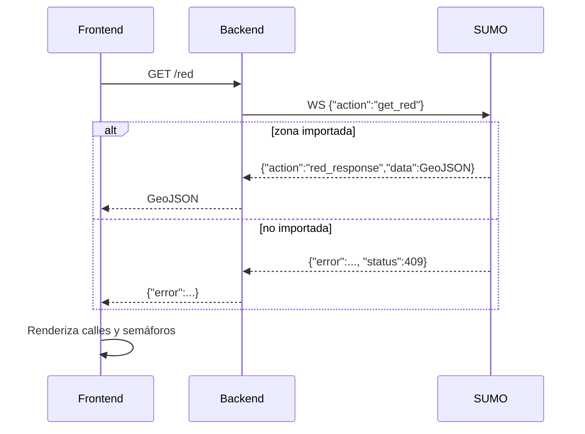


### CU-08 Modificar infraestructura vial (calle)
| Campo | Valor |
|---|---|
| Precondición | Red visible; calle seleccionada (`edge_id`) |
| Endpoints | `PATCH /escenarios/{escenario_id}/infraestructura/{edge_id}` (persistente) o `PATCH /infraestructura/{edge_id}` (proxy a SUMO, en memoria) |
| Entrada | `ModificarEdge`: `{"carriles":3,"velocidad_max":60}` (`carriles` 1–10, `velocidad_max` 5–120) |
| Salida | `EscenarioResponse` actualizado (ruta de escenario) / `{"action":"infra_response","ok":true,"edge_id":...}` (proxy) |
| Efecto | Se reemplaza el elemento con el mismo `edge_id` en `modificaciones_edges` |

**Alterno:** valores fuera de rango → `422`; escenario inexistente → `404 EscenarioNotFoundException`.

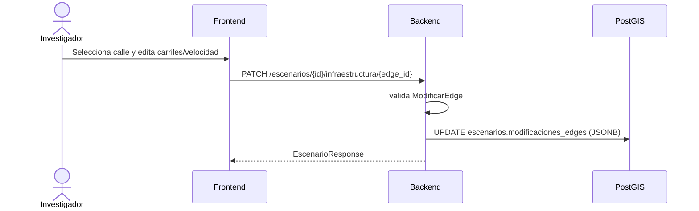


### CU-09 Modificar fases de semáforos
| Campo | Valor |
|---|---|
| Endpoints | `PATCH /escenarios/{escenario_id}/semaforo/{tls_id}` o `PATCH /semaforo/{tls_id}` (proxy SUMO) |
| Entrada | `ModificarSemaforo`: `{"fases":[{"indice":0,"duracion":30,"estado":"GGrr"}]}` (`duracion` 1–300 s) |
| Salida | `EscenarioResponse` / `{"action":"semaforo_response","ok":true,"tls_id":...}` |
| Efecto | Se reemplaza el elemento con el mismo `tls_id` en `modificaciones_semaforos` |

El flujo es análogo al de CU-08 (sustituyendo `infraestructura/{edge_id}` por `semaforo/{tls_id}`).


### CU-10 Configurar demanda vehicular

**Mejora planificada:** la demanda se definirá como **flujos** `{id, edge_origen, edge_destino, veh_h, pct_pesados?}` más volumen general (veh/h) y % de pesados; se validará que origen/destino existan y tengan ruta posible. Fuentes adicionales: CSV (CU-21) y MQTT (CU-23 a CU-25). Hoy solo existen `demanda_vehicular` y `duracion_segundos`.

| Campo | Valor |
|---|---|
| Actor | Investigador |
| Datos | `demanda_vehicular: int` (default 100), `duracion_segundos: int` (default 3600), opcionalmente `tipo_demanda: str` e `interseccion_ref: str` |
| Persistencia | Se guardan al crear/actualizar el escenario (CU-11/CU-12) |
| Uso inmediato | Se pueden enviar sobrescritos en el payload de simulación (CU-13); tienen prioridad sobre los del escenario |


### CU-11 Guardar escenario

**Mejora planificada:** CU-19 (crear desde red base, sin importar de OSM).

| Campo | Valor |
|---|---|
| Precondición | Existe el proyecto (`proyecto_id`) |
| Endpoint | `POST /escenarios/` → `201` |
| Entrada | `CreateEscenario` (`proyecto_id`, `nombre` obligatorios) |
| Salida | `EscenarioResponse` (`zona_geom` convertida de WKB a GeoJSON) |
| Posterior | `modificaciones_*` se añaden con CU-08/CU-09 o `PUT` (CU-12) |

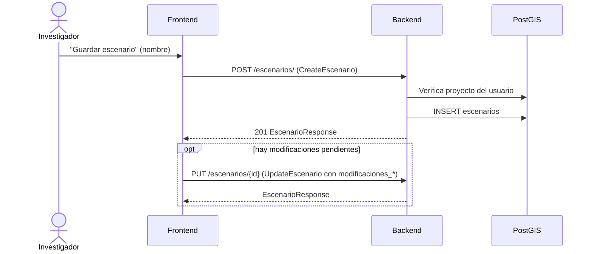


### CU-12 Gestionar escenarios
| Operación | Endpoint | Entrada | Salida |
|---|---|---|---|
| Listar | `GET /escenarios/?proyecto_id=<int>` | filtro opcional | `list[EscenarioResponse]` |
| Consultar | `GET /escenarios/{escenario_id}` | — | `EscenarioResponse` |
| Actualizar | `PUT /escenarios/{escenario_id}` | `UpdateEscenario` | `EscenarioResponse` |
| Eliminar | `DELETE /escenarios/{escenario_id}` | — | confirmación (elimina resultados en cascada) |

Todas requieren JWT. Inexistente → `404 EscenarioNotFoundException`.


### CU-13 Ejecutar simulación con progreso en tiempo real

**Mejora planificada:** (1) validar que el escenario esté completo y rechazar una segunda simulación activa del mismo escenario; (2) **nunca reimportar la zona**: parte de la red base; (3) construir red/rutas del escenario con `netconvert` (CU-22); (4) controlar SUMO por **TraCI** con semilla fija (duración por defecto 7200 s), enviar posiciones por WebSocket (CU-27) y soportar cancelación (se descartan resultados parciales); (5) calcular y persistir indicadores (CU-28).

| Campo | Valor |
|---|---|
| Actores | Investigador, Backend, Servicio SUMO, Overpass API |
| Precondición | Proyecto con `geometria` y escenario guardado (`escenario_id`) |
| Canal | WebSocket `ws://<host>:8000/ws/simular` (alternativa REST: `POST /simular` con el mismo payload, devuelve la respuesta final) |
| Entrada | `{"escenario_id":7,"duracion_segundos":1800,"demanda_vehicular":200}` (todos opcionales) |
| Salida | Mensajes `progress` y mensaje final `completado` con `resultado` (indicadores, ver 3.3) |
| Postcondición | `ULTIMO_RESULTADO` en memoria de SUMO (consultable con `GET /resultado`); el backend reenvía los indicadores a `POST /resultado-sumo` |

**Flujo principal**
1. El usuario pulsa "Simular"; el frontend abre el WebSocket y envía el payload.
2. El backend responde `iniciando` (5 %) y abre un WebSocket hacia SUMO con `{"action":"simular","payload":...}`.
3. SUMO, si hay `escenario_id`, consulta `GET /escenarios/{id}` y `GET /proyectos/{proyecto_id}` al backend para obtener modificaciones, demanda, duración y rutas de archivos.
4. SUMO aplica `modificaciones_edges` y `modificaciones_semaforos`, genera la demanda y corre la simulación, emitiendo `progress`.
5. SUMO procesa `tripinfo.xml` / `queue.xml` y envía `simular_response` con los indicadores.
6. El backend envía `completado` al frontend, que muestra el modal de resultados.

**Alternos:** SUMO inaccesible → `{"status":"error","message":"No se pudo conectar al microservicio SUMO"}`; JSON inválido → `{"error":"Invalid JSON format"}`; fallo interno → `{"error": "<detalle>"}`; Overpass saturado (429/504) → hasta 3 reintentos alternando servidor.

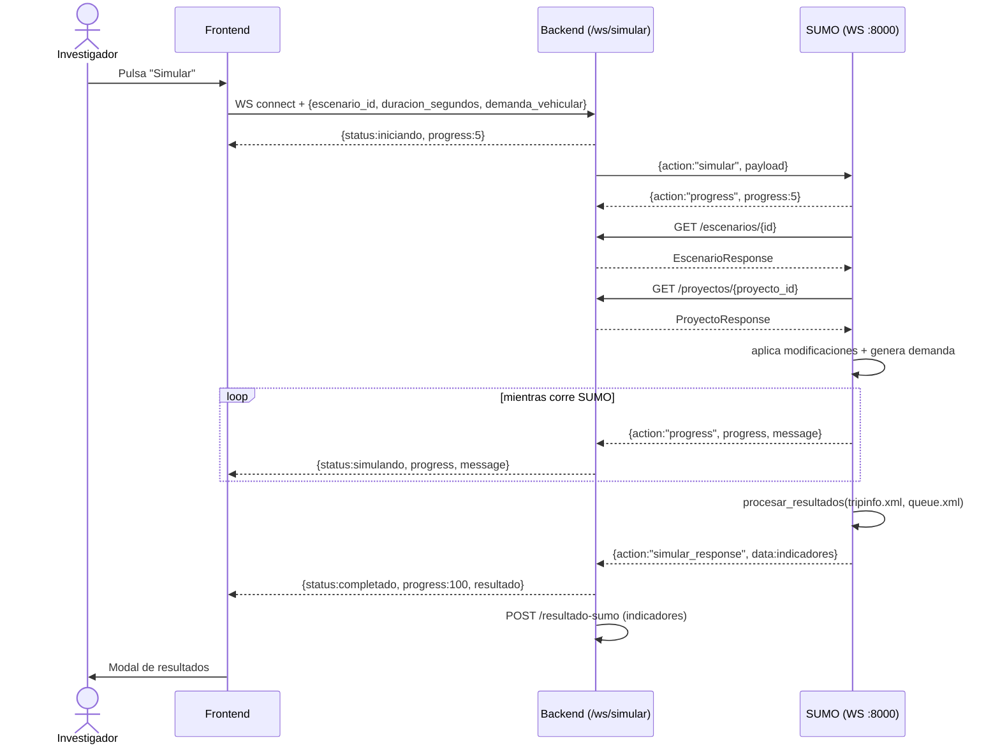


### CU-14 Consultar y guardar resultados de simulación

**Mejora planificada:** el backend guardará los indicadores automáticamente al recibirlos de SUMO (hoy `/resultado-sumo` solo imprime) y marcará el escenario como "disponible para comparación". Si el backend falla, SUMO registrará el estado y permitirá reenviar. Se incluirán indicadores por flujo y nivel de servicio.

| Campo | Valor |
|---|---|
| Precondición | Simulación completada (CU-13) y escenario guardado |
| Guardar | `POST /resultados/crear` → `201`, entrada `CreateResultado`, salida `ResultadoResponse` |
| Listar | `GET /resultados/?escenario_id=<int>` → `list[ResultadoResponse]` |
| Consultar | `GET /resultados/{resultado_id}` → `ResultadoResponse` |
| Eliminar | `DELETE /resultados/{resultado_id}` |
| Último resultado de SUMO | `GET /resultado` → `{"action":"resultado_response","data":{indicadores}}` |

**Ejemplo de entrada**
```json
{ "escenario_id": 7, "tiempo_promedio_espera": 12.34, "velocidad_promedio": 28.5,
  "longitud_max_fila": 41.0, "vehiculos_atendidos": 100 }
```
Alias aceptados: `espera_promedio`, `vehiculos_simulados`. Escenario inexistente → `404 EscenarioNotFoundException`; resultado inexistente → `404 ResultadoNotFoundException`.

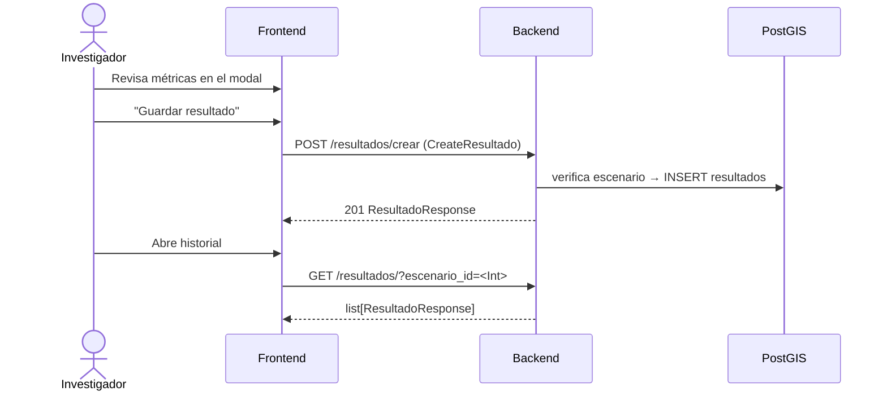


### CU-16 Guardar y consultar puntos geoespaciales
| Operación | Endpoint | Entrada | Salida |
|---|---|---|---|
| Guardar | `POST /points` → `201` | `PointsPayload`: `{"points":[{"id":"p1","lat":19.43,"lng":-99.13,"geoJson":{"type":"Feature","properties":{},"geometry":{"type":"Point","coordinates":[-99.13,19.43]}},"street":"Reforma","displayName":"..."}]}` | Puntos guardados |
| Listar | `GET /points` | — | Todos los puntos |
| Consultar | `GET /points/{point_id}` | `point_id: str` | Un punto |

Estos endpoints **no requieren JWT**. Errores: `500 CantSavePoint/CantReadPoint`, `404 DoesntExistPoints`.


---

## 6. Casos de uso en desarrollo (WIP) y simulados

Casos de uso actualmente en desarrollo activo o prototipados de forma simulada en memoria.

### CU-15 Comparar escenarios por métricas (WIP)

| Estado | WIP (Work in Progress) |
|---|---|

**Mejora planificada:** el backend calculará la tabla comparativa con **escenario base**, porcentaje de mejora, nivel de servicio y puntos críticos, con gráficas y mapas comparativos. Si un escenario no tiene simulación finalizada, se indicará cuál y se ofrecerá ejecutarla.

| Campo | Valor |
|---|---|
| Precondición | Existen resultados de al menos dos escenarios del mismo proyecto |
| Datos | `GET /escenarios/?proyecto_id=P` y `GET /resultados/?escenario_id=E` por cada uno |
| Métricas a comparar | `tiempo_promedio_espera` (menor es mejor), `velocidad_promedio` (mayor es mejor), `longitud_max_fila` (menor es mejor), `vehiculos_atendidos` |
| Resultado | El usuario decide qué intervención mejora el tráfico |

La comparación la realiza el cliente; el backend solo entrega los datos.


### CU-17 Monitoreo de vehículos por minuto (gemelo digital, MQTT)

| Estado | Pendiente (simulado) |
|---|---|

**Mejora planificada:** hoy el suscriptor guarda el historial solo en memoria y con un único tópico. Se evolucionará a tópicos por acceso/intersección, normalización por ventana de tiempo, almacenamiento en base de datos y aplicación a la simulación activa (CU-23 a CU-26).

| Campo | Valor |
|---|---|
| Actores | Simulador MQTT, `gemelo_service` |
| Canal | MQTT, broker `localhost:1883`, tópico `transystem/vehiculos_por_minuto` |
| Mensaje | `{"vehiculos_por_minuto": 42, "timestamp": "2026-11-10T18:00:00"}` |
| Efecto | El suscriptor agrega `{timestamp, vehiculos_por_minuto}`|
| Alterno | Mensaje inválido → se registra un warning y se descarta |

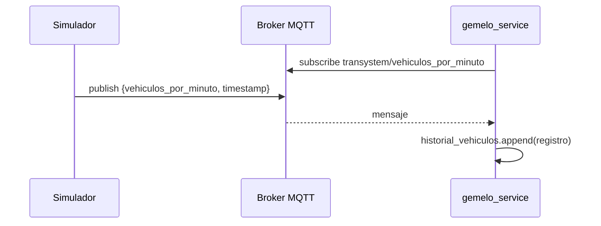


### CU-22 Construir red y archivos SUMO del escenario (WIP)

| Campo | Descripción |
|---|---|
| Actor | Sistema |
| Precondición | Simulación iniciada y red base disponible |
| Flujo principal | 1. Ubica la carpeta del escenario dentro de la del proyecto. 2. Parte de la red base y aplica con `netconvert` `modificaciones_edges` y `modificaciones_semaforos` → **red del escenario**. 3. Genera rutas y flujos de demanda. 4. Crea el archivo de configuración `.sumocfg`. |
| Alternos | Modificación sobre tramo o semáforo inexistente → el trabajo falla y se notifica. Demanda no generable → falla y se notifica. |
| Postcondición | Archivos listos; red base intacta |


### CU-27 Visualizar simulación en el mapa (WIP)

| Campo | Descripción |
|---|---|
| Actor | Investigador |
| Precondición | Simulación en ejecución o finalizada |
| Datos propuestos | Mensajes WebSocket por paso: `{"action":"estado","t":int,"vehiculos":[{"id":str,"lat":float,"lng":float,"vel":float}],"colas":[{"edge_id":str,"longitud":float}]}` (hoy solo se envía `progress`) |
| Flujo principal | 1. Abre el mapa del escenario. 2. Ve vehículos en movimiento, filas y puntos de congestión. 3. Puede pausar, acelerar o reiniciar la visualización. |


### CU-28 Calcular y almacenar indicadores (WIP)

| Campo | Descripción |
|---|---|
| Actor | Sistema |
| Precondición | Simulación finalizada con archivos de resultados |
| Flujo principal | 1. Procesa `tripinfo.xml` / `queue.xml`. 2. Calcula indicadores generales (espera, longitud máxima de fila, velocidad, vehículos atendidos, **nivel de servicio**). 3. Si hay flujos, calcula indicadores **por flujo**. 4. Envía al backend con `escenario_id`.  |
| Alternos | No se pueden procesar resultados → simulación fallida, no se envía nada. Backend no responde → se registra el estado y se permite reenviar. |
| Hoy | Indicadores generales ya existen (ver 3.3)|


---

## 7. Casos de uso planificados

Casos de uso diseñados y especificados funcionalmente para próximas iteraciones del sistema.

### 7.1 Arquitectura de escenarios: red base vs. red del escenario

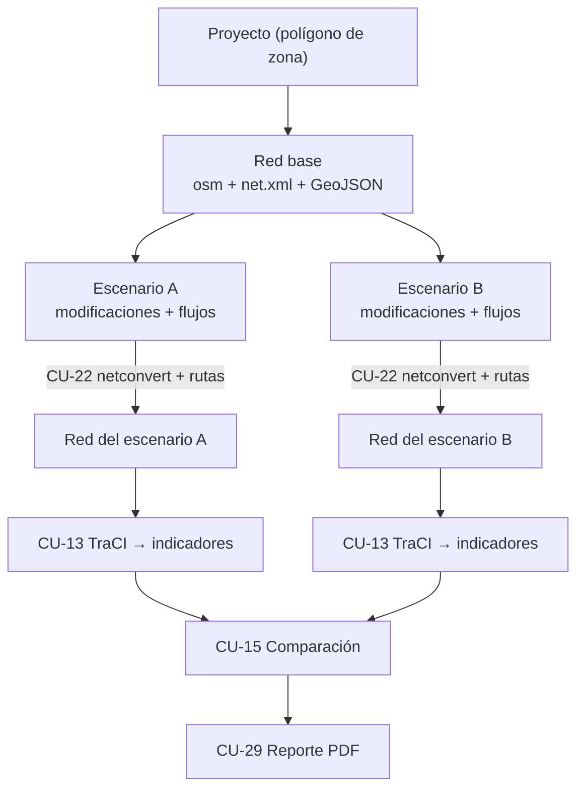

> **Regla de negocio:** la red base nunca se modifica; las modificaciones solo afectan al escenario.


### CU-19 Crear escenario a partir de la red base (planificado - corregir front)

| Campo | Descripción |
|---|---|
| Actor | Investigador |
| Precondición | El proyecto tiene red base |
| Entrada | `CreateEscenario` mínimo: `{proyecto_id, nombre}` |
| Flujo principal | 1. "Nuevo escenario" dentro del proyecto. 2. Captura el nombre. 3. El sistema lo asocia a la red base **sin importar nada de OSM**. 4. Se muestra la red base en el mapa. 5. Se guarda sin modificaciones (situación actual). |
| Alterno | Proyecto sin red base → no se permite crear escenarios y se indica completar la importación |
| Postcondición | Escenario listo para CU-08, CU-09 y CU-10 |


### CU-20 Duplicar escenario como alternativa (planificado)

| Campo | Descripción |
|---|---|
| Actor | Investigador |
| Precondición | Existe un escenario guardado |
| Flujo principal | 1. Selecciona "Duplicar". 2. El sistema copia infraestructura (`modificaciones_*`) y demanda. 3. El usuario ajusta parámetros (p. ej. verde de 30 s a 45 s, un carril extra). 4. Guarda el nuevo escenario. |
| Datos propuestos | `POST /escenarios/{id}/duplicar` → `EscenarioResponse` (sin `resultado`) |
| Postcondición | Alternativa lista para simular y comparar |


### CU-21 Cargar aforos desde archivo CSV (planificado)

| Campo | Descripción |
|---|---|
| Actor | Investigador |
| Precondición | Escenario creado |
| Entrada | Archivo CSV con aforos (columnas propuestas: `edge_origen, edge_destino, veh_h, pct_pesados`) |
| Flujo principal | 1. Sube el CSV. 2. El sistema valida columnas y tramos. 3. Convierte las filas en flujos del escenario. |
| Alterno | Fila inválida o tramo inexistente → se reporta fila y motivo |


### 7.2 Flujo de demanda en tiempo real por MQTT

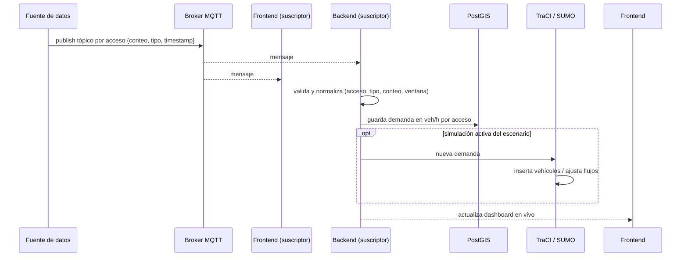


### CU-23 Publicar datos de demanda (planificado)

| Campo | Descripcion |
|---|---|
| Actor | Fuente de datos. |
| Precondición | broker disponible y permiso de publicación. |
| Flujo | la fuente mide conteos y publica en el tópico del acceso o intersección | 
| Alterno | broker caído → reintenta o guarda localmente | 
| Hoy | solo existe el tópico `transystem/vehiculos_por_minuto` (CU-17). |


### CU-24 Recibir y normalizar demanda (planificado)

| Campo | Descripcion |
|---|---|
| Actor | Sistema (suscriptor MQTT). |
| Precondición | escenario vinculado a tópicos. 
| Flujo | recibe el mensaje, valida estructura, normaliza acceso, tipo de vehículo, conteo y marca de tiempo, agrega por ventana y convierte a veh/h por acceso, y guarda en la base. 
| Alterno | mensaje inválido → se descarta y se registra. |


### CU-25 Aplicar demanda en tiempo real a la simulación (planificado)

| Campo | Descripcion |
|---|---|
|Actor| Sistema.| 
|Precondición| simulación activa y demanda nueva.| 
|Flujo| detecta la simulación activa del escenario, envía la demanda al módulo TraCI, que inserta vehículos o ajusta flujos.| 
|Alterno| sin simulación activa → se guarda como histórica del escenario.


### CU-26 Visualizar demanda en vivo (planificado)

| Campo | Descripcion |
|---|---|
|Actor| Investigador|
|Precondición| Escenario con demanda en tiempo real activa|
| Flujo| Abre el dashboard del escenario y ve los flujos por acceso, actualizados conforme llegan los datos.|


---

## 8. Casos de uso por probar

Casos de uso implementados a nivel de generación/descarga de reportes, pendientes de validación y pruebas integrales.

### CU-29 Generar reporte técnico PDF (Por probar)

| Campo | Descripción |
|---|---|
| Actor | Investigador |
| Precondición | Comparación generada (CU-15) |
| Flujo principal | 1. "Generar reporte". 2. El sistema arma mapa del área, configuración de cada escenario, gráficas, comparación y conclusiones. 3. Renderiza el PDF. 4. Guarda el reporte y los archivos de resultados. |
| Alterno | Falla de renderizado → se informa y se permite reintentar |


### CU-30 Consultar y descargar reportes (Por probar)

| Campo | Descripción |
|---|---|
|Actor| Investigador| 
|Precondición| El escenario fue simulado|
| Flujo|En el frontend se habilita el boton de descragar reporte, se hace el reporte y se manda por base64|


---

## 9. Catálogo de errores

| HTTP | Excepción | Cuándo | Estado |
|---|---|---|---|
| 400 | `EmailAlreadyRegisteredException` | Correo duplicado al registrar/modificar | Implementado |
| 401 | `InvalidCredentialsException` | Login con datos faltantes o incorrectos | Implementado |
| 401 | `InvalidTokenException` | JWT ausente, inválido o expirado | Implementado |
| 404 | `UserNotFoundException` | Usuario del token no existe | Implementado |
| 404 | `ProyectoNotFoundException` | Proyecto inexistente o ajeno | Implementado |
| 404 | `EscenarioNotFoundException` | Escenario inexistente | Implementado |
| 404 | `ResultadoNotFoundException` | Resultado inexistente | Implementado |
| 404 / 500 | `DoesntExistPointsException`, `CantSavePointException`, `CantReadPointException` | Puntos | Implementado |
| 422 | `Validación Pydantic` | Tipos o rangos inválidos (p. ej. `carriles` > 10) | Implementado |
| 409 | `Zona sin importar / simulación activa` | CU-07 (ya devuelto por SUMO como `status: 409` en el cuerpo), CU-13 | Implementado / Planificado |
| 423 | `Cuenta bloqueada temporalmente` | Exceso de intentos de login | Planificado |

## 10. Notas y observaciones

**Estado actual (código)**
- **Rutas REST de SUMO sin JWT:** `/red`, `/infraestructura/{edge_id}`, `/semaforo/{tls_id}`, `/resultado`, `/simular` y `/ws/simular` no validan autenticación en el backend.
- **Estado global en SUMO:** `/infraestructura` y `/semaforo`  extraen las  modificaciones del payload que pasa el backend, mientras que las rutas bajo `/escenarios/...` las persisten en la base de datos.
- **longitud_max_fila** puede ser `null` si no se generó `queue.xml`.
- **Reenvío de resultados:** tras simular, el backend publica los indicadores a `http://localhost:8000/resultado-sumo`, endpoint de prueba que solo imprime. Para persistir un resultado hay que usar `POST /resultados/crear` (CU-14).
- Las validaciones de propiedad por usuario en escenarios y resultados se infirieron de las firmas de los routers; confirma en `services/` si necesitas precisión absoluta.
