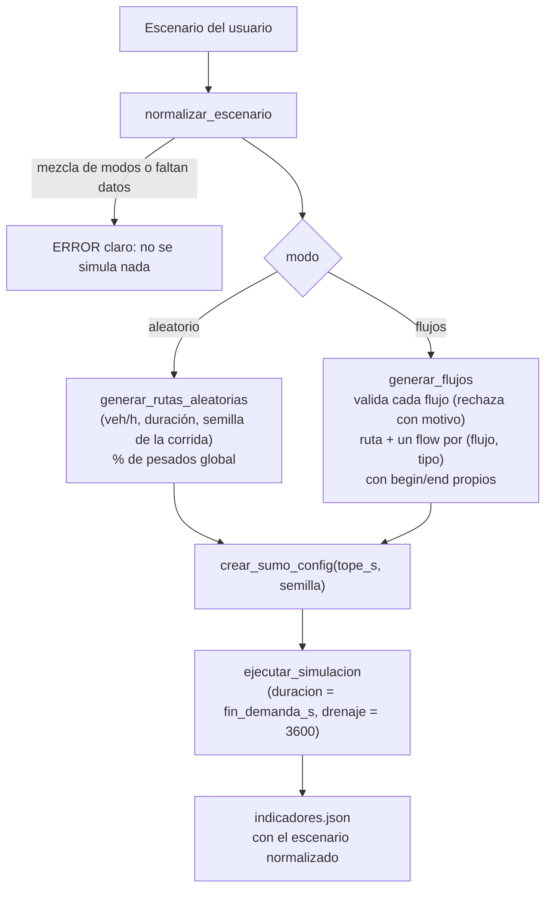

# Guía de demanda y tiempo de simulación

Estado: **propuesta, todavía sin implementar**. Es el contrato que se acuerda con frontend y backend *antes* de tocar código.

## 1. Reglas en una página

1. Hay **dos modos de demanda y no se mezclan**: aleatorio o flujos. Si no mandan `flujos`, es aleatorio.
2. La demanda siempre se expresa en **vehículos por hora (veh/h)**.
3. Si llegan campos de los dos modos a la vez, el escenario se **rechaza con un error claro**. Nada se ignora en silencio. Un campo en `null` cuenta como ausente.
4. **El tiempo viaja en segundos desde la medianoche** (7:00 = 25200, 8:00 = 28800). La pantalla muestra horas; el frontend convierte.
5. **La simulación siempre arranca en el segundo 0.** En modo flujos, el segundo 0 es la hora de inicio más temprana de todos los flujos.
6. **El tiempo se calcula en un solo lugar** (`normalizar_escenario`) y de ahí se pasa al `.sumocfg` y al motor.

## 2. Qué ve el usuario y qué manda el frontend

| Pantalla | Contrato |
|---|---|
| "Hora de inicio: 08:00" (selector de hora, formato según el usuario) | `desde_s: 28800` |
| "Hora de término: 09:00" | `hasta_s: 32400` |
| "Vehículos por hora: 800" | `vehiculos_por_hora: 800` |
| "% de vehículos pesados: 10" | `porcentaje_pesados: 10` |
| "Horas simuladas: 2" (solo modo aleatorio; de 1 a 3, admite decimales) | `duracion_segundos: 7200` |

El formato 12 h o 24 h es un asunto de la pantalla. Al contrato siempre llegan segundos desde la medianoche.

Rango válido: `0 <= desde_s < hasta_s <= 86400`. No se soportan simulaciones que crucen la medianoche.

## 3. Modo aleatorio (el de por omisión)

```json
{
  "id": 30, "proyecto_id": 3, "nombre": "Base aleatoria",
  "modificaciones_edges": [], "modificaciones_semaforos": [],
  "demanda_vehicular": 800,
  "porcentaje_pesados": 10,
  "duracion_segundos": 3600
}
```

- `demanda_vehicular` es **veh/h**, no un total. 800 veh/h durante 1800 s generan 400 vehículos.
- La simulación empieza en el segundo 0 y **no tiene hora del día** (no hay un perfil de demanda). En el PDF se describe como "primeras N horas simuladas" (con N = duración), no como "7:00 a 8:00".
- **La duración es libre entre 1 h y 3 h.** La pantalla pide "horas simuladas" (1, 1.5, 2.5...) y el frontend la convierte a segundos. Los 3600 de los ejemplos son solo un ejemplo.
- **Texto sugerido para la pantalla:** "La demanda es constante durante toda la simulación, así que simular más horas repite el mismo comportamiento. Máximo 3 horas."
- Recomendación: **no inventar un 7:00 por omisión.** Poner una hora del día implica que el modelo sabe algo de esa hora, y no es así. Si el frontend quiere una etiqueta, puede mandar `reloj_inicio_s` (opcional, solo para mostrar). No cambia la simulación.

## 4. Modo flujos

```json
{
  "id": 31, "proyecto_id": 3, "nombre": "Hora pico",
  "modificaciones_edges": [], "modificaciones_semaforos": [],
  "flujos": [
    {"id": "via", "origen": "8640976#9", "destino": "126678383#0",
     "vehiculos_por_hora": 800, "porcentaje_pesados": 10,
     "desde_s": 28800, "hasta_s": 32400},
    {"id": "lateral", "origen": "843659372", "destino": "126678383#0",
     "vehiculos_por_hora": 400, "porcentaje_pesados": 5,
     "desde_s": 30600, "hasta_s": 32400}
  ]
}
```

- Cada flujo trae **todo lo suyo**: veh/h, % de pesados y ventana. El flujo no hereda nada del escenario.
- Una sola ventana por flujo. Si alguien necesita dos horarios en el mismo tramo, define dos flujos con ids distintos.
- `origen`, `destino` y `via` son ids de **tramo** (como `8640976#9`), los mismos que da el GeoJSON.

## 5. Qué se rechaza

| Caso | Efecto |
|---|---|
| Vienen `flujos` **y** `demanda_vehicular` | Escenario rechazado: *"mezcla demanda aleatoria y flujos; usa solo uno"* |
| Vienen `flujos` **y** `duracion_segundos`, `inicio_s`, `fin_s` o `porcentaje_pesados` a nivel escenario | Escenario rechazado (mismo motivo) |
| Modo aleatorio y falta `demanda_vehicular`, `porcentaje_pesados` o `duracion_segundos` | Escenario rechazado: dice cuál falta |
| Flujo sin `porcentaje_pesados` | Flujo rechazado con motivo |
| `hasta_s <= desde_s`, `desde_s < 0` o `hasta_s > 86400` | Flujo rechazado |
| Ventana menor a 60 s (por confirmar) | Flujo rechazado |
| `vehiculos_por_hora <= 0` | Flujo rechazado |
| Modo aleatorio con `duracion_segundos` fuera de 3600 a 10800 (1 a 3 h) | Escenario rechazado |
| Modo flujos con duración total (mayor `hasta_s` menos menor `desde_s`) fuera de 3600 a 28800 (1 a 8 h) | Escenario rechazado |
| Ningún flujo se pudo aplicar | Escenario rechazado (ya existe hoy) |

Un flujo rechazado se anota en `reporte_demanda.json` y la simulación sigue con los demás, como hoy.

## 6. Qué calcula `normalizar_escenario`

Corre al inicio de `simular_escenario`. Recibe el escenario del usuario y regresa uno completo, que es el que se guarda en `indicadores.json` (así el archivo es reproducible).

**Ejemplo, modo flujos** (el JSON de la sección 4):

| Dato | Cálculo | Valor |
|---|---|---|
| modo | hay `flujos` | `"flujos"` |
| `reloj_inicio_s` | el menor `desde_s` | 28800 (8:00) |
| ventana de `via` | 28800-28800 a 32400-28800 | 0 a 3600 |
| ventana de `lateral` | 30600-28800 a 32400-28800 | 1800 a 3600 |
| esperados de `via` | 800 x 3600 / 3600 | 800 |
| esperados de `lateral` | 400 x 1800 / 3600 | 200 |
| `fin_demanda_s` | el mayor `hasta_s` recorrido | 3600 |
| `tope_s` | `fin_demanda_s` + 3600 de drenaje | 7200 |

**Ejemplo, modo aleatorio** (el JSON de la sección 3): modo `"aleatorio"`, `fin_demanda_s` = 3600, `tope_s` = 7200, esperados = 800.

Si el usuario elige 8:00 a 9:00 o 7:00 a 8:00, SUMO simula exactamente lo mismo (0 a 3600). La hora real solo cambia lo que dice el PDF.

## 7. El recorrido



## 8. Qué cambia en cada función

| Archivo | Función | Hoy | Cambio |
|---|---|---|---|
| `main.py` o `escenario_demanda.py` | `normalizar_escenario` | no existe | Detecta modo, rechaza mezclas, recorre el reloj, calcula `fin_demanda_s` y `tope_s` |
| `main.py` | `simular_escenario` | calcula `duracion` suelto | Usa lo normalizado; pasa el **mismo** `tope_s` al `.sumocfg` y al motor (cierra P0-4) |
| `escenario_demanda.py` | `_planear_flujo` | usa `inicio_s`/`fin_s` globales | Usa `desde_s`/`hasta_s` del flujo; exige `porcentaje_pesados`; `esperados` por flujo |
| `escenario_demanda.py` | `_escribir_rou` | `begin`/`end` globales | `begin`/`end` de cada flujo |
| `data_generators.py` | `generar_rutas_aleatorias` | `tiempo_insercion=3600` y `semilla=42` fijos | Recibe duración y semilla de la corrida (cierra P1-2 y P1-3) |
| `data_generators.py` | `crear_sumo_config` | `end=7200` por omisión | Recibe `tope_s` y la semilla real |
| `gestion_reportes.py` | `describir_configuracion` | imprime campos del formato viejo | Imprime la ventana de cada flujo; con `reloj_inicio_s`, en hora del día |
| `escenario_demanda.py` | `indicadores_por_flujo` | recorta el id del vehículo | **Sin cambios** (el id `via__auto.N` sigue igual con una sola ventana) |

Detalle que ya existe: `_limpiar_id` permite `__` dentro del id de un flujo, y el id de cada vehículo se parte justo por `__`. Conviene prohibirlo al validar.

## 9. Compatibilidad

- Los `indicadores.json` viejos siguen siendo legibles. Solo los escenarios nuevos se normalizan.
- `ESCENARIO_PRUEBA` de `main.py` hay que ajustarlo: trae `flujos` junto con `demanda_vehicular`, `inicio_s`, `fin_s`, `duracion_segundos` y `porcentaje_pesados`, y con la regla nueva sería rechazado. Quitar esos campos y poner `desde_s: 0` y `hasta_s: 3600` dentro del flujo.
- **Prueba de no regresión:** con ese ajuste, el escenario 21 debe dar números idénticos a `referencia/indicadores_21_antes.json` (800 atendidos, 103.98 s de espera, 11.75 km/h, fila de 162.92 m).

## 10. Lo que se le dice al frontend y al backend

1. Hay dos modos. Si el usuario no elige flujos, es aleatorio.
2. Aleatorio pide tres datos: veh/h, % de pesados y duración.
3. Flujos pide, por cada flujo: origen, destino, veh/h, % de pesados, hora de inicio y hora de término.
4. Las horas viajan en **segundos desde la medianoche**; la pantalla muestra horas en el formato que prefiera.
5. No se pueden mandar campos de los dos modos a la vez. Si pasa, el servidor responde con el motivo.
6. Las horas deben estar entre 0 y 86400, con término mayor que inicio.

## 11. Limitaciones (para el manual técnico)

- **Sin perfil dentro de un flujo:** la demanda es uniforme en su ventana. Un perfil por hora se arma con varios flujos del mismo origen y destino.
- **Los indicadores son promedios de toda la corrida.** Con flujos en horarios distintos, mezclan momentos distintos. Los datos para separarlos existen (`tripinfo` trae `depart`), pero no se calculan.
- **Sin calentamiento:** la red arranca vacía, así que los primeros minutos están sesgados.
- **Demanda aleatoria sin hora del día** y sin perfil.
- Llegadas a intervalos regulares (`vehsPerHour`), no aleatorias.
- Simulaciones que cruzan la medianoche no se soportan.
- **Por qué 3 h en aleatorio y 8 h en flujos.** En aleatorio la demanda es uniforme, así que más horas repiten el mismo comportamiento (siempre que la red no esté saturada: con una cola que crece sin parar, más horas sí cambian el resultado). En flujos, en cambio, las franjas pueden ser distintas (pico de la mañana, valle, tarde), así que una duración larga sí aporta información.
- **`queue.xml` en corridas largas.** Se puede borrar o comprimir tras calcular la fila máxima, pero el pico de disco ocurre *durante* la corrida (SUMO lo va escribiendo), así que borrarlo después no evita el espacio que ocupa mientras corre. Hay que medirlo con una corrida real de 8 h antes de dar el tope por bueno. `trayectorias.json` crece con el número de vehículos y no se borra (el frontend lo necesita).
- El drenaje fijo de 3600 s puede quedar corto con colas largas; `termino_completo` avisa cuando pasa. Con los topes, la simulación más larga dura 3 h + 1 h = 4 h simuladas en aleatorio y 8 h + 1 h = 9 h en flujos.

## 12. Decisiones tomadas y por confirmar

| Decisión | Estado |
|---|---|
| Dos modos que no se mezclan; mezcla = error | Decidido |
| Tiempo en segundos desde la medianoche; la pantalla muestra horas | Decidido |
| Segundo 0 = hora de inicio más temprana (se recorre el reloj) | Decidido |
| Modo aleatorio sin hora del día (`reloj_inicio_s` opcional, solo etiqueta) | Propuesto |
| `porcentaje_pesados` obligatorio por flujo | Decidido |
| Ventana mínima **por flujo** de 60 s (el mínimo de 1 h aplica a la duración total del escenario, no a cada flujo) | Por confirmar |
| Modo aleatorio: horas simuladas de 1 a 3 (decimales permitidos), con aviso de que más horas repiten lo mismo | Decidido |
| Modo flujos: duración total de 1 a 8 h; el tope de 8 h se valida midiendo el `queue.xml` de una corrida real | Propuesto |

## 13. Orden de implementación

1. `normalizar_escenario` con sus validaciones (se prueba solo, sin correr SUMO).
2. Ajustar `ESCENARIO_PRUEBA` y `_planear_flujo` / `_escribir_rou`. Comparar contra la referencia del escenario 21.
3. `simular_escenario`: pasar `tope_s` al config y al motor.
4. `generar_rutas_aleatorias`: duración y semilla.
5. `describir_configuracion` y el PDF.
6. Avisar al equipo del contrato (sección 10).